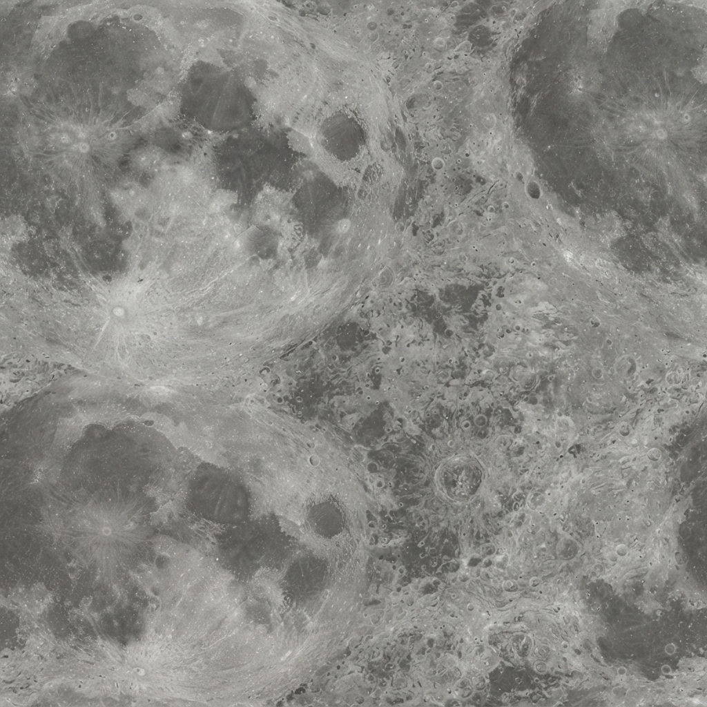

# 🌙 RealidadeVirtual — Lua em Realidade Aumentada + Museu Virtual 3D

Projeto que combina **Realidade Aumentada (RA)** e **Realidade Virtual (RV)** no navegador, usando **A-Frame** e **AR.js**.

- **Realidade Aumentada:** a câmera do celular reconhece um marcador e faz aparecer uma **Lua 3D girando** sobre ele.
- **Realidade Virtual:** o botão **"Veja mais →"** abre um **museu 3D** com 4 paredes, cada uma com uma foto da Lua.

>  **Como usar este guia:** clique nos botões azuis/verdes/etc. abaixo. Cada um abre o `index.html` no GitHub já com as **linhas do código destacadas**.

---

## 📑 Índice

1. [Visão geral: um arquivo, dois modos](#1--visão-geral-um-arquivo-dois-modos)
2. [Onde está a Realidade Aumentada](#2--onde-está-a-realidade-aumentada)
3. [Onde está a Realidade Virtual](#3--onde-está-a-realidade-virtual)
4. [O que faz a Lua girar](#4--o-que-faz-a-lua-girar)
5. [A imagem da Lua (textura)](#5--a-imagem-da-lua-textura)
6. [O botão "Veja mais"](#6--o-botão-veja-mais)
7. [Onde está o link do GitHub](#7--onde-está-o-link-do-github)
8. [Mapa dos arquivos do projeto](#8--mapa-dos-arquivos-do-projeto)
9. [Como executar e testar](#9--como-executar-e-testar)

---

## 1. 🔀 Visão geral: um arquivo, dois modos

Todo o projeto está em **um único arquivo: `index.html`**. Ele decide qual modo abrir olhando a URL:

| URL | Modo | Função chamada |
|---|---|---|
| `.../RealidadeVirtual/` | 📷 Realidade Aumentada | `iniciarAR()` |
| `.../RealidadeVirtual/?sala=1` | 🥽 Realidade Virtual (museu) | `iniciarSala()` |

[](https://github.com/jclclick/RealidadeVirtual/blob/main/index.html#L55)
[](https://github.com/jclclick/RealidadeVirtual/blob/main/index.html#L295-L298)

**Como funciona:** a constante `MODO_SALA` (linha 55) verifica se existe `?sala` na URL. No final do arquivo (linha 295), se for `true` roda `iniciarSala()`, senão roda `iniciarAR()`.

---

## 2. 📷 Onde está a Realidade Aumentada

Tudo da RA está dentro da função **`iniciarAR()`**.

[_completa-linhas_74–138-success?style=for-the-badge)](https://github.com/jclclick/RealidadeVirtual/blob/main/index.html#L74-L138)

| O que faz | Botão |
|---|---|
| Carrega as bibliotecas **A-Frame** e **AR.js** | [](https://github.com/jclclick/RealidadeVirtual/blob/main/index.html#L80-L81) |
| Cria a **cena AR** e configura a **câmera/webcam** (resolução, taxa de detecção, método de rastreio) | [](https://github.com/jclclick/RealidadeVirtual/blob/main/index.html#L83-L95) |
| Define as **luzes** da cena | [](https://github.com/jclclick/RealidadeVirtual/blob/main/index.html#L96-L97) |
| Cria o **marcador** (`<a-marker>`) que o celular precisa reconhecer | [](https://github.com/jclclick/RealidadeVirtual/blob/main/index.html#L99-L112) |
| Entidade da **câmera virtual** | [](https://github.com/jclclick/RealidadeVirtual/blob/main/index.html#L114-L114) |
| Detecta quando o marcador é **encontrado** / **perdido** e atualiza o texto de status | [](https://github.com/jclclick/RealidadeVirtual/blob/main/index.html#L118-L138) |

**Como funciona:**
1. O AR.js abre a câmera do celular (`sourceType: webcam`, linha 88).
2. Ele procura na imagem o desenho do marcador, descrito no arquivo `pattern-lua.patt`.
3. Quando encontra, dispara o evento `markerFound` (linha 123) e o texto muda para **"Marcador da Lua reconhecido!"**.
4. Tudo que está **dentro** da tag `<a-marker>` (linhas 99–112) fica "grudado" no marcador — por isso a Lua aparece sobre ele.
5. Se o marcador some, dispara `markerLost` (linha 130) e o status volta para **"Procurando marcador da Lua..."**.

---

## 3. 🥽 Onde está a Realidade Virtual

Tudo da RV (o museu) está dentro da função **`iniciarSala()`**.

[_completa-linhas_141–293-blueviolet?style=for-the-badge)](https://github.com/jclclick/RealidadeVirtual/blob/main/index.html#L141-L293)

| O que faz | Botão |
|---|---|
| **Lista das 4 fotos** das paredes e seus títulos | [](https://github.com/jclclick/RealidadeVirtual/blob/main/index.html#L57-L63) |
| **Tamanho da sala** (8 m × 8 m × 4 m) e limite de caminhada | [](https://github.com/jclclick/RealidadeVirtual/blob/main/index.html#L151-L154) |
| Lê o tamanho real das fotos para **não distorcer** | [](https://github.com/jclclick/RealidadeVirtual/blob/main/index.html#L156-L162) |
| **Posição e rotação** de cada parede (frente, direita, atrás, esquerda) | [](https://github.com/jclclick/RealidadeVirtual/blob/main/index.html#L164-L170) |
| Monta cada **parede + moldura + foto + título + luz** | [](https://github.com/jclclick/RealidadeVirtual/blob/main/index.html#L172-L194) |
| Cria a **cena 3D**, **chão**, **teto** e a **câmera do visitante** | [](https://github.com/jclclick/RealidadeVirtual/blob/main/index.html#L196-L212) |
| **Arrastar** com um dedo = olhar ao redor | [](https://github.com/jclclick/RealidadeVirtual/blob/main/index.html#L259-L264) |
| **Pinça** com dois dedos = andar para frente/trás | [](https://github.com/jclclick/RealidadeVirtual/blob/main/index.html#L265-L271) |
| **Roda do mouse** = andar (no computador) | [](https://github.com/jclclick/RealidadeVirtual/blob/main/index.html#L278-L281) |
| Função `andar()` que **limita** o movimento para não atravessar a parede | [](https://github.com/jclclick/RealidadeVirtual/blob/main/index.html#L236-L242) |
| Texto **"Parede X de 4"** que indica para onde você está olhando | [](https://github.com/jclclick/RealidadeVirtual/blob/main/index.html#L228-L232) |
| Tela de **"Entrando no museu..."** que some depois | [](https://github.com/jclclick/RealidadeVirtual/blob/main/index.html#L289-L291) |

**Como funciona:** o código desenha uma sala quadrada com 4 paredes. Cada parede recebe uma moldura preta e uma foto da lista `PAREDES`. A câmera fica no centro da sala (altura 1,6 m, como os olhos de uma pessoa) e o visitante controla com toque/mouse.

---

## 4. 🔄 O que faz a Lua girar

A rotação é feita por **uma única propriedade `animation`** na esfera da Lua:

[](https://github.com/jclclick/RealidadeVirtual/blob/main/index.html#L110-L110)

```html
animation="property: rotation; to: 0 360 0; loop: true; dur: 18000; easing: linear"
```

| Parte | Significado |
|---|---|
| `property: rotation` | anima a **rotação** do objeto |
| `to: 0 360 0` | gira **360°** no eixo Y (vertical) |
| `loop: true` | repete **para sempre** |
| `dur: 18000` | uma volta completa a cada **18 segundos** (18000 ms) |
| `easing: linear` | velocidade **constante**, sem acelerar nem frear |

> ✏️ **Quer mudar a velocidade?** Altere o `dur`. Valor menor = gira mais rápido (ex.: `5000`); maior = mais devagar.

A esfera completa (tamanho, posição e material) está aqui:
[](https://github.com/jclclick/RealidadeVirtual/blob/main/index.html#L106-L111)

---

## 5. 🖼️ A imagem da Lua (textura)

A "pele" da Lua (as crateras e manchas) vem de uma imagem aplicada sobre a esfera 3D:

[](https://github.com/jclclick/RealidadeVirtual/blob/main/index.html#L109-L109)

```html
material="src: textura-lua.jpg; roughness: 0.9; metalness: 0.05"
```

| Parte | Significado |
|---|---|
| `src: textura-lua.jpg` | arquivo da imagem usada como textura |
| `roughness: 0.9` | superfície **bem fosca** (a Lua não brilha como metal) |
| `metalness: 0.05` | quase **nada metálica** |

📁 Arquivo da imagem: [`textura-lua.jpg`](https://github.com/jclclick/RealidadeVirtual/blob/main/textura-lua.jpg)

<p align="center"></p>

**Outras imagens do projeto:**

- 🧩 **Marcador reconhecido pela câmera** (a imagem que você aponta com o celular): [`pattern-lua.patt`](https://github.com/jclclick/RealidadeVirtual/blob/main/pattern-lua.patt) (dados de reconhecimento), [`Lua.png`](https://github.com/jclclick/RealidadeVirtual/blob/main/Lua.png) e PDFs [`marcador_lua.pdf`](https://github.com/jclclick/RealidadeVirtual/blob/main/marcador_lua.pdf) / [`marcadores_luas.pdf`](https://github.com/jclclick/RealidadeVirtual/blob/main/marcadores_luas.pdf) (para imprimir)
- 🖼️ **Fotos das paredes do museu** (usadas no modo RV):

| Parede | Arquivo | Título no museu |
|---|---|---|
| 1 | [`lua_por_inteiro_parede1.webp`](https://github.com/jclclick/RealidadeVirtual/blob/main/lua_por_inteiro_parede1.webp) | A Lua por inteiro |
| 2 | [`fotodalua_da_terra_parede2.webp`](https://github.com/jclclick/RealidadeVirtual/blob/main/fotodalua_da_terra_parede2.webp) | A Lua vista da Terra |
| 3 | [`representacao-das-fases-da-lua_parede3.webp`](https://github.com/jclclick/RealidadeVirtual/blob/main/representacao-das-fases-da-lua_parede3.webp) | As fases da Lua |
| 4 | [`homem_na_lua_parede4.webp`](https://github.com/jclclick/RealidadeVirtual/blob/main/homem_na_lua_parede4.webp) | O homem na Lua |

[](https://github.com/jclclick/RealidadeVirtual/blob/main/index.html#L57-L63)

---

## 6. 🔘 O botão "Veja mais"

O botão tem **três partes**: o HTML, o estilo (CSS) e a lógica que o faz aparecer.

| Parte | O que faz | Botão |
|---|---|---|
| **HTML** | Cria o link/botão `Veja mais →` que leva para `?sala=1` (o museu) | [](https://github.com/jclclick/RealidadeVirtual/blob/main/index.html#L75-L78) |
| **CSS** | Visual: branco, arredondado, fixo embaixo da tela, com sombra | [-linhas_17–25-red?style=for-the-badge)](https://github.com/jclclick/RealidadeVirtual/blob/main/index.html#L17-L25) |
| **Aparecer** | Começa **escondido** (`display: none`) e só aparece com a classe `visivel` | [](https://github.com/jclclick/RealidadeVirtual/blob/main/index.html#L24-L24) |
| **Lógica** | Quando a câmera reconhece o marcador, adiciona a classe `visivel` | [](https://github.com/jclclick/RealidadeVirtual/blob/main/index.html#L123-L128) |
| **Persistência** | Quando o marcador some, o botão **continua** na tela | [](https://github.com/jclclick/RealidadeVirtual/blob/main/index.html#L130-L135) |

**Como funciona:**
1. O botão existe desde o início, mas está **invisível**.
2. Quando o marcador é reconhecido (`markerFound`), a linha 127 (`botao.classList.add("visivel")`) o revela com uma animação suave (`@keyframes surgir`, linha 25).
3. Ao clicar, abre `?sala=1` **em nova aba** (`target="_blank"`) → entra no museu de Realidade Virtual.

---

## 7. 🔗 Onde está o link do GitHub

Há **dois pontos** do código com links:

| Link | Para que serve | Botão |
|---|---|---|
| `https://jclclick.github.io/RealidadeVirtual/pattern-lua.patt` | Endereço **no GitHub Pages** do arquivo do marcador. O AR.js baixa esse arquivo para aprender a reconhecer a imagem | [](https://github.com/jclclick/RealidadeVirtual/blob/main/index.html#L102-L102) |
| `href="?sala=1"` | Link **interno** do botão "Veja mais" (abre o museu no mesmo site) | [](https://github.com/jclclick/RealidadeVirtual/blob/main/index.html#L77-L77) |

> ⚠️ **Atenção:** se você mudar o nome do usuário ou do repositório no GitHub, precisa **atualizar a linha 102**, senão o marcador não será encontrado.

As bibliotecas externas (A-Frame e AR.js) também são carregadas por links: [](https://github.com/jclclick/RealidadeVirtual/blob/main/index.html#L80-L81)

---

## 8. 🗂️ Mapa dos arquivos do projeto

| Arquivo | Para que serve |
|---|---|
| [`index.html`](https://github.com/jclclick/RealidadeVirtual/blob/main/index.html) | **Todo o código** (RA + RV + botão) |
| [`textura-lua.jpg`](https://github.com/jclclick/RealidadeVirtual/blob/main/textura-lua.jpg) | Imagem aplicada na esfera da Lua |
| [`pattern-lua.patt`](https://github.com/jclclick/RealidadeVirtual/blob/main/pattern-lua.patt) | Padrão do marcador lido pelo AR.js |
| [`Lua.png`](https://github.com/jclclick/RealidadeVirtual/blob/main/Lua.png) / [`lua.jfif`](https://github.com/jclclick/RealidadeVirtual/blob/main/lua.jfif) | Imagem do marcador da Lua |
| [`marcador_lua.pdf`](https://github.com/jclclick/RealidadeVirtual/blob/main/marcador_lua.pdf) / [`marcadores_luas.pdf`](https://github.com/jclclick/RealidadeVirtual/blob/main/marcadores_luas.pdf) | Marcadores prontos para imprimir |
| [`lua_por_inteiro_parede1.webp`](https://github.com/jclclick/RealidadeVirtual/blob/main/lua_por_inteiro_parede1.webp) | Foto da parede 1 |
| [`fotodalua_da_terra_parede2.webp`](https://github.com/jclclick/RealidadeVirtual/blob/main/fotodalua_da_terra_parede2.webp) | Foto da parede 2 |
| [`representacao-das-fases-da-lua_parede3.webp`](https://github.com/jclclick/RealidadeVirtual/blob/main/representacao-das-fases-da-lua_parede3.webp) | Foto da parede 3 |
| [`homem_na_lua_parede4.webp`](https://github.com/jclclick/RealidadeVirtual/blob/main/homem_na_lua_parede4.webp) | Foto da parede 4 |

---

## 9. ▶️ Como executar e testar

### 9.1 Publicação no GitHub Pages

1. Acesse o repositório no GitHub em [jclclick/RealidadeVirtual](https://github.com/jclclick/RealidadeVirtual).
2. Vá até a aba **Settings** e, no menu lateral esquerdo, clique em **Pages**.
3. Em **Build and deployment > Branch**, selecione a branch `main` e a pasta `/(root)`, depois clique em **Save**.
4. Aguarde de 1 a 2 minutos. O endereço público ficará disponível em:
   **https://jclclick.github.io/RealidadeVirtual/**

### 9.2 Preparação do marcador

- Utilize a imagem do marcador com a borda preta externa gerada no AR.js Marker Training (ou a imagem marcadora correspondente).
- Exiba a imagem na tela de um monitor/tablet ou imprima em papel, com boa iluminação e sem reflexos intensos.

### 9.3 Execução no dispositivo móvel

1. Abra o navegador do celular (Chrome, Safari etc.) e acesse: https://jclclick.github.io/RealidadeVirtual/
2. Quando o navegador pedir permissão para usar a câmera, clique em **Permitir** (a conexão HTTPS do GitHub Pages é necessária para o acesso à câmera).
3. Aponte a câmera para o marcador da Lua a cerca de **30 a 50 cm**, mantendo toda a borda do marcador dentro do enquadramento.
4. Assim que o marcador for reconhecido:
   - O status no topo mudará para **"Marcador da Lua reconhecido!"**.
   - A Lua 3D texturizada aparecerá flutuando e girando sobre o marcador.
   - O botão **"Veja mais →"** aparecerá na parte de baixo da tela.
5. Ao afastar a câmera ou cobrir o marcador, o status volta para **"Procurando marcador da Lua..."** (o botão continua visível).
6. Clique em **"Veja mais →"** para entrar no museu virtual 3D. Lá: **arraste** para olhar ao redor e use a **pinça** (ou a roda do mouse) para andar.

### 💡 Dicas para melhor rastreamento

- **Iluminação e reflexos:** evite luz forte refletindo na tela ou no papel, pois isso atrapalha a leitura da borda do marcador.
- **Distância e enquadramento:** se o objeto parecer grande demais ou perder o rastreamento, ajuste a distância até enquadrar o marcador completo com nitidez.

---

<sub>Tecnologias: [A-Frame 1.6.0](https://aframe.io/) · [AR.js 3.4.8](https://github.com/AR-js-org/AR.js)</sub>
